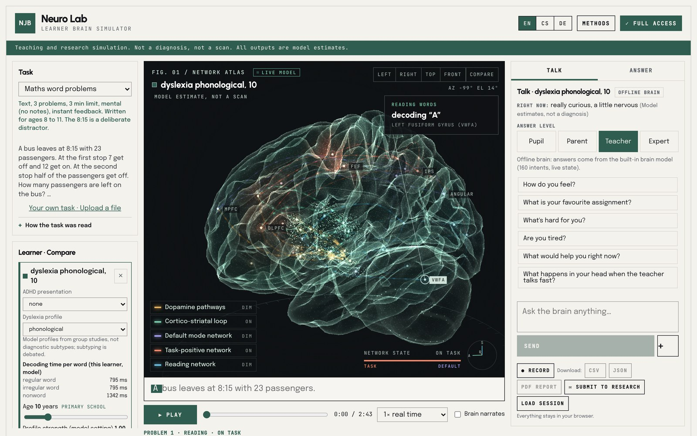
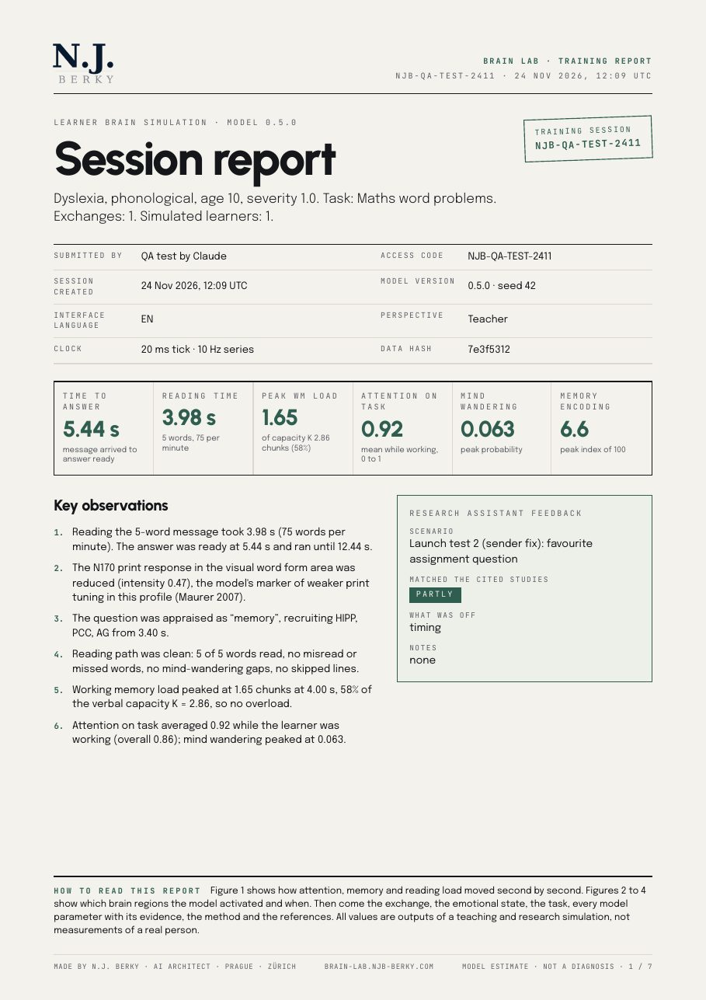
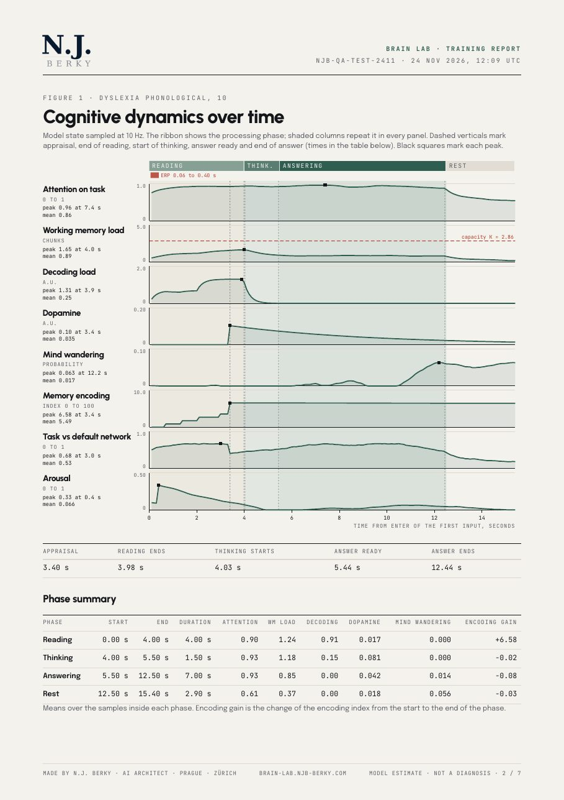
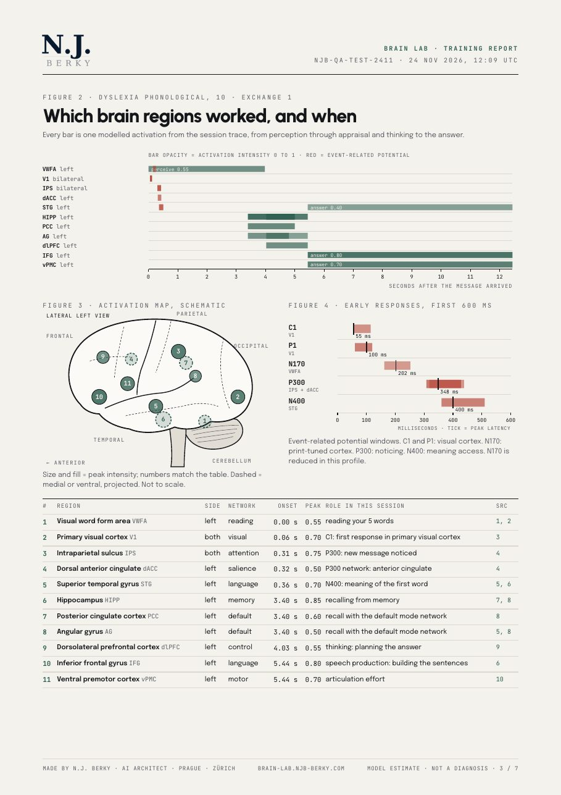
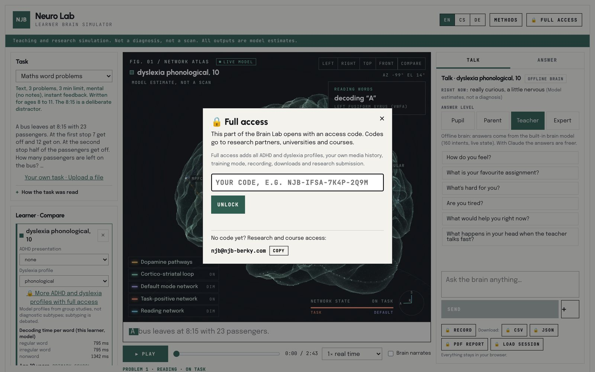
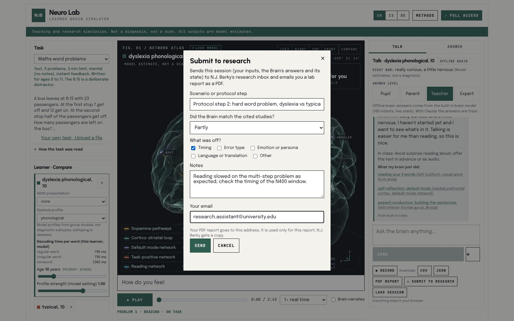
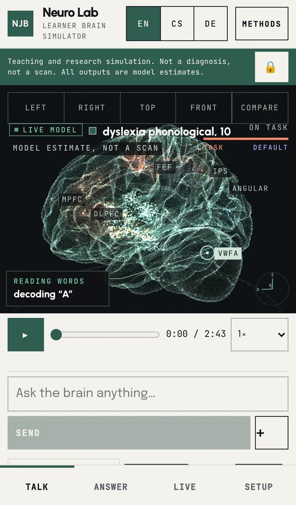

# NJB Brain Lab · Learner Brain Simulator

**Live:** https://brain-lab.njb-berky.com (English · Čeština · Deutsch)

A teaching and research simulation of how a learner's brain reads, thinks and answers, built for teachers, researchers and students in education. You pick a learner (typical development, three ADHD presentations, three dyslexia profiles, age, screen and social media history), give it a task or a message, and watch attention, working memory, reading load, dopamine, mind wandering and memory encoding move second by second across a 3D brain.

Every parameter of the model is tied to published research. The Lab ships with **124 references** and an evidence grade for each parameter.

> Not a diagnosis. Outputs are model estimates of a simulation built from group-level research. They do not describe, assess or diagnose any real child or student.

## What it does

- **Learner profiles:** typical development, ADHD (inattentive, hyperactive-impulsive, combined) and dyslexia (phonological, surface, mixed), each with sourced parameters and evidence grades.
- **Tasks and talk:** maths word problems, reading tasks or free messages. The learner reads, appraises, thinks and answers, with a classroom or home tip for the teacher or parent.
- **Live brain:** a 3D brain atlas with networks (reading, language, attention, salience, default mode, dopamine) lit by the model in real time, plus early event-related potentials (C1, P1, N170, P300, N400).
- **Development:** screen and social media history by year of age, projected onto attention, inhibition and reward, with uncertainty bands.
- **Training mode:** train a learner over sessions, save it, load it and compare it with the baseline.
- **Three languages:** the whole Lab, its methods and its reports run fully in EN, CS and DE.

## Lab-grade PDF report for every research session

When a research assistant submits a session, the Lab builds a 7-page A4 report and emails it to the research inbox and to the submitter, in the session's language.

| Summary and key findings | Cognitive dynamics over time | Brain regions over time |
|---|---|---|
|  |  |  |

The report covers: key observations written from the data, eight measures over time with processing phases, a timeline of brain region activations, a schematic activation map, early ERP windows, the exchange and the learner's answer, emotional state, the timing of every processing stage, all model parameters with range, evidence grade and sources, methods, and the full reference list with DOIs.

## Access

| | Public | Full access (time-limited research code) |
|---|---|---|
| Play with the brain, all three languages | ✓ | ✓ |
| Typical, ADHD combined, dyslexia phonological | ✓ | ✓ |
| All ADHD and dyslexia profiles, own media history, training | | ✓ |
| Recording, downloads (video, CSV, JSON, PDF) | | ✓ |
| Submit sessions to research, PDF report by email | | ✓ |

Research access codes go to universities, research assistants and courses. They are time-limited and device-limited.

## Science basis (selection)

- Dehaene S, Cohen L. The unique role of the visual word form area in reading. *Trends Cogn Sci* 2011;15(6):254-62. doi:10.1016/j.tics.2011.04.003
- Maurer U et al. Impaired tuning of a fast occipito-temporal response for print in dyslexic children learning to read. *Brain* 2007;130(12):3200-10. doi:10.1093/brain/awm193
- Richlan F, Kronbichler M, Wimmer H. Functional abnormalities in the dyslexic brain: a quantitative meta-analysis of neuroimaging studies. *Hum Brain Mapp* 2009;30(10):3299-308. doi:10.1002/hbm.20752
- Cowan N. The magical number 4 in short-term memory. *Behav Brain Sci* 2001;24(1):87-114. doi:10.1017/s0140525x01003922
- Kofler MJ et al. Reaction time variability in ADHD: a meta-analytic review of 319 studies. *Clin Psychol Rev* 2013;33(6):795-811. doi:10.1016/j.cpr.2013.06.001
- Seli P et al. On the relation of mind wandering and ADHD symptomatology. *Psychon Bull Rev* 2015;22(3):629-36. doi:10.3758/s13423-014-0793-0

The full list of 124 references, with the evidence grade of every parameter, is in the Lab under **Methods**.

## How it is built

- Single-page React and three.js app; the full version ships encrypted (AES-256-GCM) and opens only with a valid code.
- Cloudflare Pages for the site, Cloudflare Workers for the access API, D1 (EU jurisdiction) for codes and research submissions.
- PDF reports rendered in a headless browser (Cloudflare Browser Run) from the same report template in EN, CS and DE.
- Privacy: the simulation runs in the browser. Sessions leave the browser only when someone submits them to research; the only personal data stored is the email address given to receive the report.

The source code is private.

## Cite

See [CITATION.cff](CITATION.cff), or:

> NJB Neuro Lab, learner brain simulator, model version 0.5.0, made by N.J. Berky, AI architect. https://brain-lab.njb-berky.com

## Contact

Research access, collaboration and courses: **njb@njb-berky.com** · https://njb-berky.com/lab

---

made by N.J. Berky · AI architect · Prague · Zürich

© 2026 N.J. Berky. All rights reserved.
